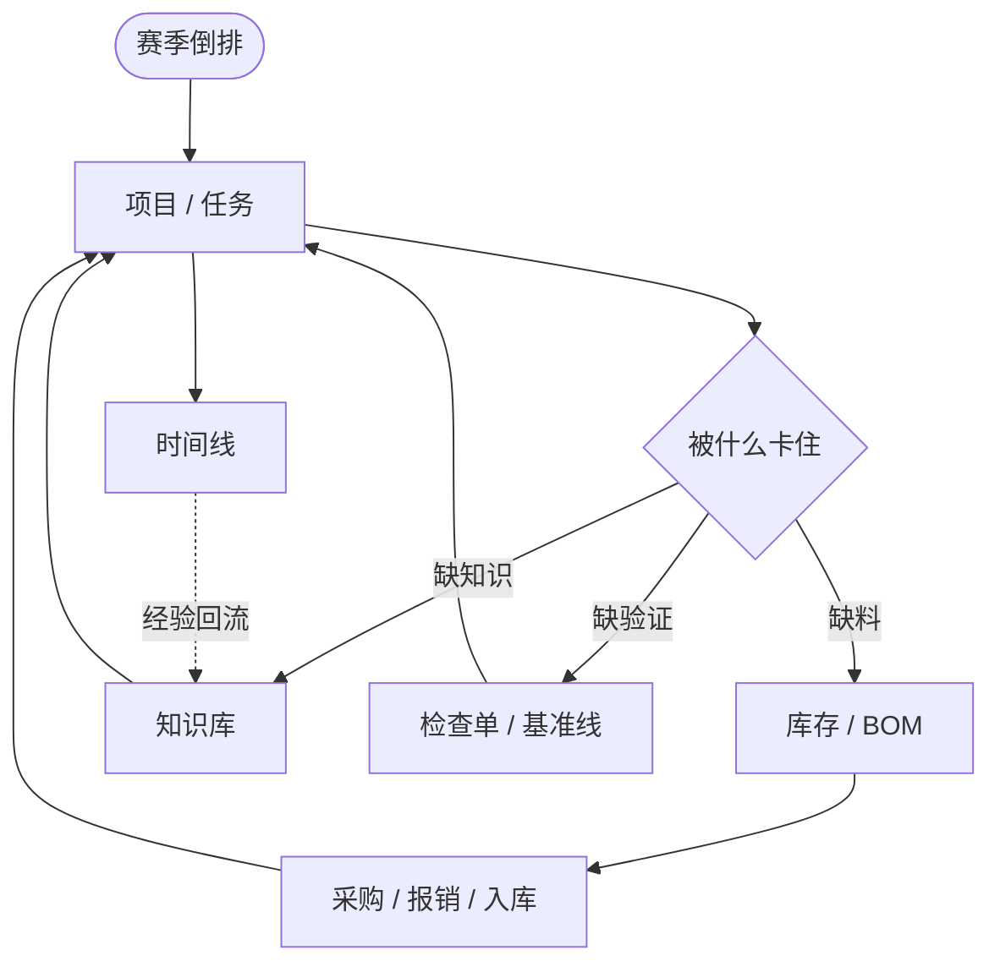
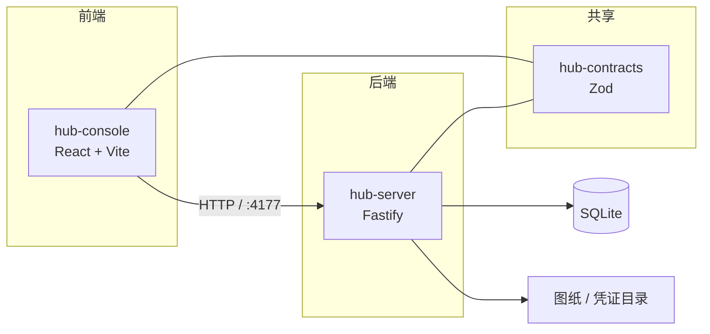

<div align="center">


# TeamHub

**机器人战队的协作中枢**

知识库 · 项目计划 · 库存 / BOM · 报销

<sub>给 5–15 人的 Robocon / RoboMaster 战队用 · 单团队 · 自部署</sub>

<br/>

[](https://github.com/Jackrainman/TeamHub/releases)
[](https://github.com/Jackrainman/TeamHub/actions/workflows/verify.yml)
[](https://nodejs.org/)

<br/>

[](docs/operations/deploy.md)
[](https://sqlite.org/)
[](https://react.dev/)
[](https://fastify.dev/)

<br/>

[五分钟跑起来](#五分钟跑起来) · [页面一览](#页面一览) · [技术形态](#技术形态) · [正式部署](#给战队正式部署) · [文档地图](#文档地图)

</div>


赛前爆肝，很多时候不是不够努力，是信息没摊开：谁在等谁、哪颗螺丝还没到、上周那个 bug 最后怎么解的。

TeamHub 把它们收进同一个地址。5–15 人的队伍，没有专职项目经理，也能看到同一份项目事实。

> **不排名，不盯人。** 系统只回答「这件事被什么卡住」，不回答「谁慢了」。

## 🧩 三根柱子

| 🧠 知识库 | 🧭 项目计划 | 📦 库存 / BOM |
|:---:|:---:|:---:|
| 调试踩过的坑结案归档。下次遇到同样的症状，先搜旧解法，而不是从头再来。 | 任务连成依赖图，哪一步被哪一步卡住一眼可见；没人认领的活进挂单池；倒排基准线告诉你离比赛还有几周。 | 零件还剩多少、缺什么；装车拆车、入库报损随手记一笔。采购、报销、入库能串成一条线。 |

共同底座还包括赛季、机器人清单、图纸档案、每日在场、学习方向、时间线和报销。

### 三条底线

| 底线 | 怎么落地 |
|---|---|
| **不排名、不盯人** | 只显示任务被什么卡住；Task 没有个人截止日；任务页的个人范围只回本人。 |
| **AI 只当仓管和转译** | 整理、检索、算量、起草可以；派活、验收、判断谁该干什么不行。 |
| **数据留在自己手里** | 单端口 + SQLite + 本地附件目录；不依赖外部数据库，也不要求 SaaS。 |

## 🗺 从赛季到经验



卡点不靠人汇报：依赖没解、物料没到、验证门没过，任务和项目视图里都会显出来。

## 🚀 五分钟跑起来

Windows PowerShell 和 Ubuntu 都可以。需要 Node.js 24.x 和 Git；SQLite 是 Node 内置的，不用另装数据库，也不用 WSL。

```bash
git clone https://github.com/Jackrainman/TeamHub.git
cd TeamHub
npm ci
npm run dev
```

浏览器打开 <http://127.0.0.1:4177>。

第一次打开会进向导：选「先试试」用一套演示数据，示例任务、车辆和排班都备好了，随便点不心疼；选「直接安装」就开始正式使用。开发数据默认放在被忽略的 `tmp/dev-data/`，不会碰服务器数据。

<details>
<summary>常用命令和测试</summary>

```bash
npm run browser:install           # 第一次跑浏览器 E2E 前
npm run verify:local              # 三包类型检查 + 单测 + 构建
npm run verify                    # CI 同款，再加 Playwright E2E
npm run dev -w apps/hub-console   # 另开终端，前端热更新
```

Windows 和 Ubuntu 各自 `npm ci`，不要复制 `node_modules`。Git Bash 只用于现有的提交钩子和版本脚本。浏览器下载受限、机器上已有 Edge 时，PowerShell 可以先设 `$env:E2E_BROWSER_CHANNEL='msedge'`。

</details>

## 🗂 页面一览

| 页面 | 干什么 |
|---|---|
| ✅ **任务** | 个人 / 全队任务网格；新建、备位验收、历史查询。 |
| 🧭 **项目** | 三列看板、依赖图、挂单池。 |
| 🧠 **知识库** | 按症状搜旧坑，问题解决后结案归档。 |
| 🧾 **报销** | 票据在浏览器本地解析；条目登记、财务核对、选中导出。 |
| 📦 **库存与 BOM** | 余量、装拆、入库、报损、缺料提醒。 |
| 📊 **总览** | 倒计时、本车与赛季进度、基准线、门检查。 |
| 📅 **每日在场** | 资源时段与接力协作，不记考勤。 |
| 📐 **图纸档案** | 按机构和版本存图纸。 |
| 🤖 **机器人清单** | 整机登记、状态维护、检查项与门检查。 |
| 🧗 **学习方向** | 按工种看技能缺口，给学弟一张地图。 |
| 🕘 **时间线** | 回看项目事实。 |
| ⚙️ **设置** | 名册与权限、语言、七套主题、字号。 |

<sub>队伍近况还在规划中，目前只有只读的赛季基准线。</sub>

## 🛠 技术形态

三个 npm workspace，依赖方向只有一条：

```text
hub-console ──→ hub-contracts ←── hub-server
```

- **hub-server**：Fastify 5，单端口 `4177` 同时托管 API 和前端静态站；数据落在 SQLite（Node 24 内置 `node:sqlite`），图纸和报销凭证放在本地目录。
- **hub-console**：React 18 + Vite 5，TypeScript，中英双语、七套主题。
- **hub-contracts**：Zod 契约，前后端共用字段和派生规则。

不抢 80/443，不依赖外部数据库。想上 HTTPS 就在前面套一层 Caddy。备份要包含数据库和两个附件目录，不能直接复制正在写入的 SQLite。

<details>
<summary>目录和请求链路</summary>



```text
apps/
├── hub-contracts/   # Zod 契约，前后端共用
├── hub-server/      # Fastify API + 静态托管
└── hub-console/     # React 控制台
docs/                # 活文档入口
scripts/             # 验证、备份、版本
```

</details>

## 📦 给战队正式部署

Ubuntu 24 Server：

```bash
git clone https://github.com/Jackrainman/TeamHub.git
cd TeamHub
npm ci
./start-teamhub.sh
```

默认只监听 `127.0.0.1:4177`。先完成向导、导入名册、跑一次备份，最后才用 `HUB_HOST=0.0.0.0` 把地址交给队友。

> **别把 4177 直接扔到公网。** 非 loopback 写端点必须过身份会话或 `TEAMHUB_WRITE_TOKEN` 写门；公网入口走 HTTPS 反代，并设 `TEAMHUB_TRUST_PROXY=true`。

测试实例和正式实例用不同的端口、数据库、图纸和凭证目录。改模式、升级或重建前，先备份并验证恢复。

- 📦 **[部署指南](docs/operations/deploy.md)**：从零到全队可用，含环境变量速查和 Docker 路径。
- 🤖 **[给 AI 助手的部署提示词](docs/operations/agent-deploy.md)**：服务器上有能执行命令的助手？把提示词粘给它。
- 🔧 **[运维 Runbook](docs/operations/runbook.md)**：备份、回滚、升级纪律。

## 📚 文档地图

| 想知道 | 从哪开始 |
|---|---|
| 队员第一次用 | [队员上手指南](docs/guide/getting-started.md) |
| 部署、开放顺序、HTTPS | [部署指南](docs/operations/deploy.md) |
| 备份、回滚、升级 | [运维 Runbook](docs/operations/runbook.md) |
| 产品边界与设计约束 | [文档总入口](docs/README.md) · [决策记录](.harness/decisions.md) |
| 仓库内部操作手册 | [AGENTS.md](AGENTS.md) |
| 以前为什么这样做 | [历史诊断库](docs/archive/README.md)（按触发条件定向查） |


<div align="center">

<sub><b>TeamHub</b> · 让每次救火都留下能复用的东西</sub>

<sub>A self-hosted collaboration hub for small robotics teams.</sub>

<sub><a href="#teamhub">回到顶部 ↑</a></sub>

</div>
